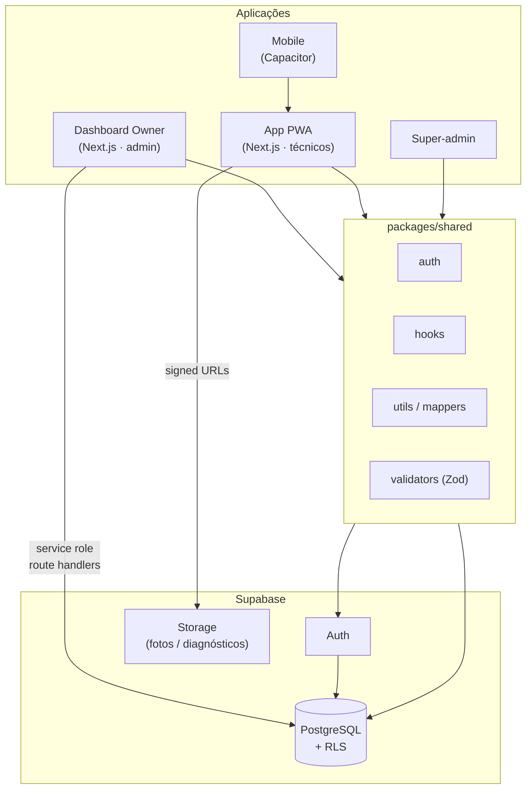
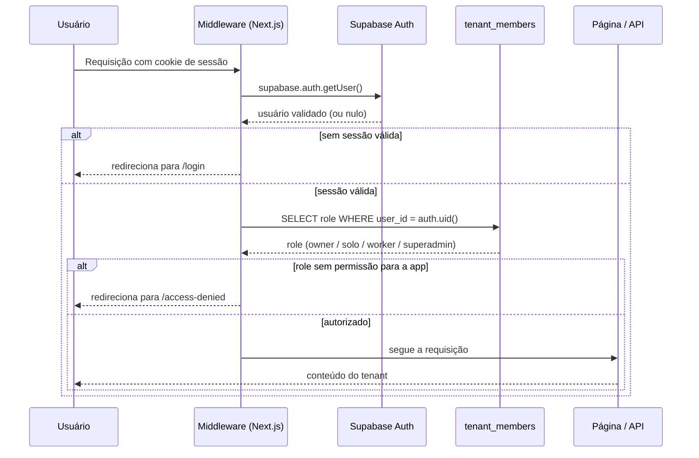
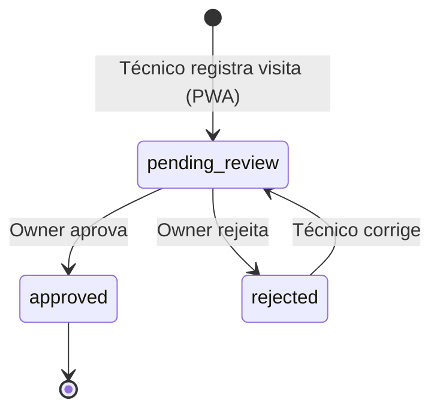
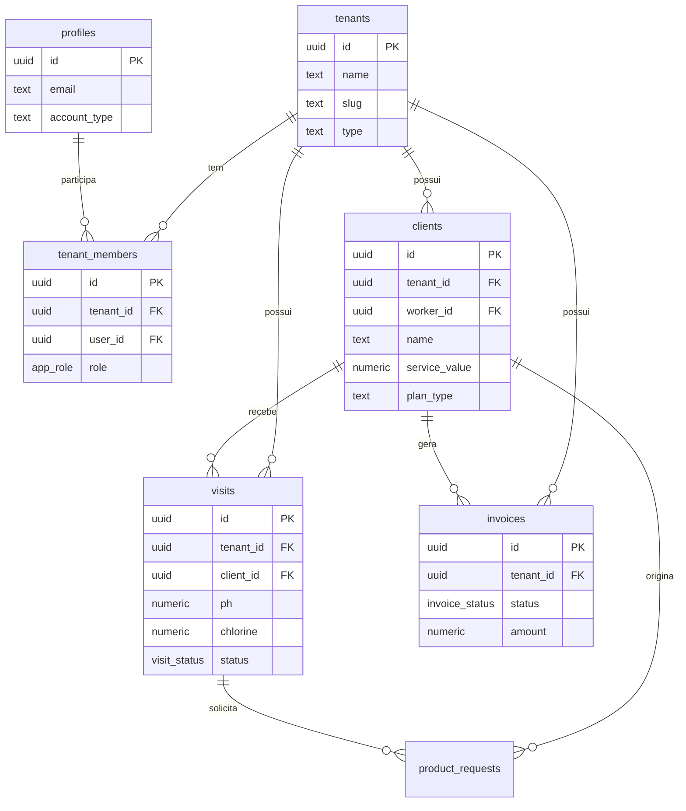

# Piscineiro Mestre — Plataforma de Gestão para Serviços de Piscina

Plataforma SaaS **multi-tenant** para empresas e profissionais autônomos de manutenção de piscinas gerenciarem clientes, rotas de visitas, controle químico da água, financeiro e equipe. O sistema é dividido em um **dashboard administrativo** (para donos de empresa) e um **app operacional PWA** (para técnicos em campo), compartilhando um núcleo de regras de negócio.

> Monorepo em TypeScript com Next.js 15 (App Router), React 19 e Supabase (PostgreSQL + Auth + RLS + Storage).

---

## Índice

- [Visão geral](#visão-geral)
- [Principais funcionalidades](#principais-funcionalidades)
- [Stack técnica](#stack-técnica)
- [Arquitetura](#arquitetura)
- [Modelo multi-tenant e segurança](#modelo-multi-tenant-e-segurança)
- [Modelo de dados](#modelo-de-dados)
- [Estrutura do monorepo](#estrutura-do-monorepo)
- [Como rodar localmente](#como-rodar-localmente)
- [Decisões de engenharia](#decisões-de-engenharia)

---

## Visão geral

O Piscineiro Mestre resolve a operação de quem presta manutenção de piscinas: cadastrar clientes mensalistas e avulsos, organizar a agenda semanal de visitas por técnico, registrar os parâmetros da água (pH, cloro, alcalinidade) em cada visita, controlar pagamentos e dar visibilidade de receita ao dono do negócio.

A plataforma atende três perfis de usuário, modelados como *roles* dentro de cada tenant:

| Perfil | Role | O que usa | O que faz |
|---|---|---|---|
| Dono de empresa | `owner` | Dashboard Owner | Gerencia clientes, equipe, financeiro e aprova visitas |
| Profissional autônomo | `solo` | Dashboard Owner | Opera sozinho, acumula funções de dono e técnico |
| Técnico de campo | `worker` | PWA | Executa visitas, registra água e solicita produtos |
| Administrador da plataforma | `superadmin` | Super-admin | Suporte e administração global |

## Principais funcionalidades

- **Gestão de clientes** — mensalistas (contrato recorrente) e avulsos (serviço esporádico), com dados da piscina (volume, modelo de filtro, troca de areia).
- **Rotas e agenda** — organização das visitas por dia da semana e por técnico, com reagendamentos temporários.
- **Registro de visita** — parâmetros químicos da água, checklist, produtos usados, foto de diagnóstico e fluxo de aprovação (`pending_review` → `approved`/`rejected`).
- **Financeiro** — faturas, status de pagamento por cliente e cálculo de receita por período, com suporte a planos mensais, semestrais e anuais.
- **Equipe** — o dono cria e remove técnicos (workers) vinculados ao seu tenant.
- **PWA instalável** — o app operacional funciona como Progressive Web App, com service worker e manifest.

## Stack técnica

**Frontend / aplicação**
- Next.js 15 (App Router) · React 19 · TypeScript
- Tailwind CSS · Radix UI · shadcn-style components · lucide-react
- Redux Toolkit + Immer (estado do PWA) · react-hook-form + Zod (formulários e validação)
- Recharts (gráficos) · date-fns

**Backend / infraestrutura**
- Supabase: PostgreSQL, Auth, Row Level Security (RLS), Storage e Realtime
- Next.js Route Handlers para operações privilegiadas (server-side, com service role)
- Sentry (observabilidade) · Vercel (deploy web) · Capacitor (empacotamento mobile)

**Monorepo**
- npm Workspaces · pacote compartilhado `@piscineiro/shared`

## Arquitetura

O sistema é um monorepo com duas aplicações Next.js que consomem o mesmo backend Supabase e compartilham autenticação, hooks e regras de negócio via `packages/shared`.



### Fluxo de autenticação e resolução de tenant

Toda requisição autenticada passa por validação de sessão no servidor e resolução do tenant a partir da tabela `tenant_members` — o `tenant_id` nunca é confiado a partir do cliente.



### Ciclo de vida de uma visita



## Modelo multi-tenant e segurança

O isolamento entre empresas é o requisito central do sistema e é garantido em camadas:

1. **Row Level Security (RLS) no PostgreSQL** — todas as tabelas de domínio têm RLS ativa. As políticas usam as funções `is_owner_of_tenant()` e `is_member_of_tenant()` (com `SECURITY DEFINER` e `search_path` fixo) para evitar recursão e vazamento entre tenants. O schema completo está em [`supabase/schema.sql`](./supabase/schema.sql).
2. **Validação de sessão no servidor** — o middleware de cada app valida a sessão com `supabase.auth.getUser()` (via `@supabase/ssr`), não apenas a presença de cookies.
3. **Autorização nas rotas privilegiadas** — operações que usam a *service role key* resolvem o usuário autenticado pelo token, confirmam o papel em `tenant_members` e derivam o `tenant_id` do servidor, ignorando qualquer `tenant_id` enviado pelo cliente.
4. **Storage com URLs assinadas** — arquivos sensíveis (fotos de diagnóstico) são servidos por URLs assinadas com expiração, não por URLs públicas.

## Modelo de dados



Entidades principais: `tenants`, `profiles`, `tenant_members`, `clients`, `ad_hoc_clients`, `visits`, `invoices`, `product_requests` e `temporary_reschedules`. Um trigger `handle_new_user` cria automaticamente o perfil e o tenant no registro de um dono/solo.

## Estrutura do monorepo

```
piscineiro-mestre-cloud/
├── apps/
│   ├── owner/            # Dashboard administrativo (Next.js)
│   │   └── src/app/      # clients, revenue, routes, team, reports, settings, api/
│   ├── pwa/              # App operacional dos técnicos (Next.js PWA)
│   │   └── src/          # app/, components/, hooks/, context/, lib/, config/
│   ├── mobile/           # Empacotamento mobile (Capacitor)
│   └── super-admin/      # Administração global da plataforma
├── packages/
│   └── shared/           # @piscineiro/shared
│       └── src/          # auth/, hooks/, utils/ (mappers), validators/ (Zod)
├── supabase/
│   └── schema.sql        # Schema consolidado: tabelas, RLS, triggers, views
└── README.md
```

## Como rodar localmente

Pré-requisitos: Node.js 20+, npm e um projeto Supabase.

```bash
# 1. Instalar dependências de todo o monorepo
npm install

# 2. Aplicar o schema no seu projeto Supabase
#    (cole o conteúdo de supabase/schema.sql no SQL Editor do Supabase)

# 3. Configurar variáveis de ambiente em cada app (apps/owner/.env.local, apps/pwa/.env.local)
#    NEXT_PUBLIC_SUPABASE_URL=...
#    NEXT_PUBLIC_SUPABASE_ANON_KEY=...
#    SUPABASE_SERVICE_ROLE_KEY=...   (apenas server-side)

# 4. Rodar o dashboard administrativo
npm run dev --workspace @piscineiro/owner

# 5. Rodar o PWA dos técnicos
npm run dev --workspace @piscineiro/pwa
```

> As chaves de serviço (`SUPABASE_SERVICE_ROLE_KEY`) são usadas somente em Route Handlers server-side e nunca expostas ao cliente.

## Decisões de engenharia

- **Monorepo com pacote compartilhado** — autenticação, hooks de dados e validações Zod ficam em `@piscineiro/shared`, evitando divergência entre o dashboard e o PWA.
- **Autorização server-side centralizada** — rotas privilegiadas derivam tenant e papel do servidor a partir de `tenant_members`, nunca do corpo da requisição, como defesa em profundidade além da RLS.
- **Schema versionado único** — todo o banco (tabelas, RLS, triggers, views) vive em um único `supabase/schema.sql` idempotente, em vez de scripts de correção dispersos.
- **Storage privado por padrão** — arquivos de diagnóstico usam URLs assinadas com expiração.
- **PWA para o campo** — o app dos técnicos é instalável e pensado para uso em dispositivos móveis durante as visitas.

---

<sub>Projeto pessoal de portfólio. Arquitetura, modelagem de dados e implementação por Michel Henrique Macedo.</sub>
